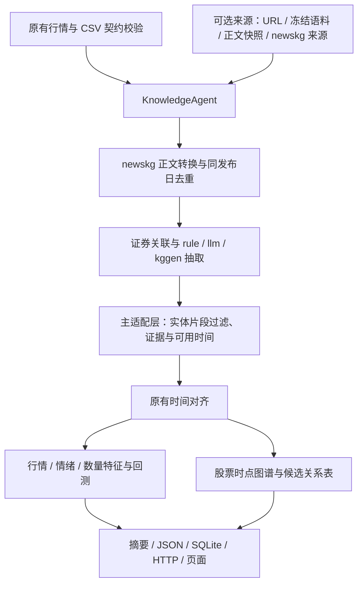

# 新闻知识模块整合与实测

> 本文记录第一轮调用适配的过程。后续已完成实现迁移，主流程不再从原子项目加载源码。当前结构、独立运行命令和最新验收见[新闻知识模块独立化验收](./新闻知识模块独立化验收.md)。

执行日期：2026-11-08。目标是把独立的 [knowlegde_merge](../knowlegde_merge/README.md) 接入主项目，并验证真实数据链路。**接线与运行已经完成；真实金融新闻的抽取质量仍不足，不能把可运行等同于事实正确或预测有效。**

## 1. 替换了哪些位置

主流程现在为：



- [knowledge.py](../stocksage/knowledge.py)：唯一的 newskg 加载入口，复用原始模型、去重和抽取器，不复制其算法；独立模块命名空间，不修改全局搜索路径。
- [news.py](../stocksage/news.py)：正文清洗/来源接口适配、冻结语料和快照重放、URL 抓取、来源失败台账、代码/长别名匹配。
- [agents.py](../stocksage/agents.py) / [pipeline.py](../stocksage/pipeline.py)：新增新闻知识角色，替换新闻输入、去重和知识抽取位置，再进入原有行情分析与预测。
- [graph.py](../stocksage/graph.py)：静态公司关系、新闻证据和 newskg 候选三元组共同构图，关系保留新闻 ID、后端与证据。
- [storage.py](../stocksage/storage.py)：新增 `knowledge_triples` 表，新闻外键与完整属性落库；同时保存包含候选关系的新闻记录。
- [server.py](../stocksage/server.py)：新增 `/api/graph?symbol=...`，与仪表盘使用同一个股票图谱。
- [页面脚本](../stocksage/web/app.js)：读取后端真实 nodes/edges；显示抽取状态、候选关系和原文证据，提供股票切换与无关系状态。
- 原抽取器 [kg/__init__.py](../knowlegde_merge/src/newskg/kg/__init__.py) 改为按后端延迟导入，默认规则模式不再强制导入 requests 或 KGGen。

价格采集、六维特征、时间回测和数值摘要保留原职责。图谱候选关系目前用于证据组织，未加入预测特征，也没有引入自动交易或 LLM 自主规划。

## 2. 输入与时间规则

| news-source | 行为 | 是否需外网/可选依赖 |
|---|---|---|
| `dataset`（默认） | 保留已校验 CSV 新闻，执行去重与抽取 | 否，rule 只用标准库 |
| `corpus` | 重放子项目 126 份冻结 Markdown | 否，rule 只用标准库 |
| `urls` | 通过 newskg 抓取 CSV 所列原始链接正文 | 是，需要新闻依赖 |
| `snapshot` | 读取本次采集生成的 manifest/documents 并校验哈希 | 否，rule 只用标准库 |
| 来源名称 | 调用 newskg 的发现、时间窗过滤和正文转换 | 是，是否需 Key 取决于来源 |

外部新闻默认 `observed`，可用时间按本次实际获得正文的时间记录；没有可靠证券关联的记录保留未关联状态，不进入任何股票特征。CSV 中原有人工关联和事件标签可在同一报道上保留。代码/长别名精确匹配不能解决所有名称歧义。

`historical_assumption` 必须显式指定：采用发布精度上界加 5 分钟。当前抓到的正文可能已经更新，所以该模式仅用于回顾性联调，不能视为历史实时可交易预测。使用原始发布时间而没有原始版本记录并不能消除未来信息风险。

同发布日内复用原始双层去重；不跨日期自动合并同标题的重复发生事件。较晚重复版本中的证券关联不回填到较早时点。来源失败、无正文、未关联、无关系和后端调用失败是不同状态；显式后端失败会中断，不静默切换。

基础 CSV 不被修改，其 SHA256 仍只描述输入 CSV/来源快照。替换后的新闻是运行时派生记录，使用独立的 `news_inputs/manifest.json` 与 `documents_sha256`；报告通过 `runtime_news_source`、`hash_scope` 和 `input_news_time_mode` 标记口径变化。

## 3. 真实运行结果

行情保持已有真实样本：贵州茅台、五粮液各 78 条，共 156 条；每次运行均生成两只股票的预测报告，共 58 次回测记录。跨股票合计不等于独立交易日数。

| 验证模式 | 新闻结果 | 知识与时间结果 |
|---|---|---|
| 真实 CSV + 默认 rule | 5 条已核验标题，全部通过 | 有效候选关系 0；不声称标题足够支持抽取 |
| 冻结语料 + rule | 126 篇读取成功，2 篇同日近似重复，保留 124 篇 | 35 条候选关系；1 篇匹配目标证券，123 篇未关联；全部晚于 2025 年行情，未进入历史股票图谱/特征 |
| 在线 URL 正文抓取 | 新华财经/新浪的 5 个原始链接均成功，失败 0 | 正文约 368—1989 字符；按实际观测时间，不进入 2025 年分析 |
| 同一真实正文快照离线重放 | 哈希校验通过，无网络请求 | 观测模式：5 篇均 pending，新闻数量/情绪特征不提前生效 |
| 显式历史回填重放 | 5 篇全部进入相应收盘桶 | 只证明接线；输出历史时间假设提示，不作为无偏预测结果 |

**实际发现并修正的问题**：规则抽取器将“通过股份回购可以让投资人看到……”切成 `通过股份 — 回购 → 可以让投资人看到贵州茅台对未`。两端虽都在原文，仍不是合格的具名实体。因此适配层增加功能短语片段过滤，保留拒绝计数并新增回归测试。最终这 5 篇正文的有效候选关系为 **0，拒绝 1**。这说明采集、正文转换、抽取调用与过滤可以运行，也说明默认模板不适合据此声称完成可靠中文金融关系抽取。

冻结语料的 35 条是通过当前结构与表面证据检查的**待核验候选**，没有在本次集成中重新逐条做人工语义标注，不等于 35 条已核验事实。候选标记保存为 `verification=unverified_candidate`。

所有四种导出模式的 SQLite 外键检查均通过。原有行情与预测流程仍可运行；此次没有以预测分数提升为验收条件。

## 4. 测试与环境

使用 Python 3.12.14。默认路径只使用标准库；联网新闻依赖安装在项目 `.venv`，未安装 KGGen 的大型依赖。

**29 项 unittest 全部通过**，包含原有 18 项与新增 11 项知识集成检查。新增覆盖：原始后端复用、片段关系过滤、重复新闻时间边界、别名歧义、关系落库与图谱接口、未来关系隔离、观测/历史回填快照、哈希及路径检查、冻结真实语料重放、后端失败处理和 LLM 本地 HTTP 协议。

LLM 协议测试使用本地假服务，不产生付费调用；确认请求发送、JSON 解析、入库前过滤及失败语义。**云端 LLM Key 未配置，真实云端 LLM/KGGen 没有运行**，不把本地假服务作为真实模型效果验收。

浏览器检查：图谱来自后端、新闻节点证据可查、股票切换、关系/空状态、真实来源链接和历史时间假设标记。JavaScript 语法检查通过。

## 5. 复现入口

```powershell
# 默认适配，无需联网
python run.py --data-dir data/real_sample --output-dir output/integration_csv --no-server
python run.py --data-dir data/real_sample --news-source corpus --news-limit 126 --output-dir output/integration_corpus --no-server

# 安装可选新闻依赖（本机已安装）
.venv/Scripts/python.exe -m pip install -r requirements-news.txt

# 新抓正文：仅原链接，默认观测时点
.venv/Scripts/python.exe run.py --data-dir data/real_sample --news-source urls --news-limit 5 --output-dir output/live --no-server

# 当前已存在的在线采集快照，离线验证观测模式
python run.py --data-dir data/real_sample --news-source snapshot --news-snapshot output/integration_live/news_inputs/manifest.json --output-dir output/integration_observed --no-server

# 显式回顾模式 + 页面（本次服务使用8767）
python run.py --data-dir data/real_sample --news-source snapshot --news-snapshot output/integration_live/news_inputs/manifest.json --news-time-mode historical_assumption --output-dir output/integration_retrospective --port 8767

python -m unittest discover -s tests -v
```

只有 Windows 启动脚本时，可用：

```powershell
powershell -ExecutionPolicy Bypass -File ./start_demo.ps1 -DataDir data/real_sample -KnowledgeBackend rule
```

脚本优先选择项目 `.venv`，也可传 `-NewsSource`、`-NewsSnapshot`、`-NewsTimeMode`、`-NewsLimit`。新闻快照与输出应为不同目录，避免改写输入。

产物：[CSV 接线报告](../output/integration_csv/report.json)、[冻结语料报告](../output/integration_corpus/knowledge_report.json)、[真实采集清单](../output/integration_live/news_inputs/manifest.json)、[观测模式](../output/integration_observed/report.json)、[回顾模式](../output/integration_retrospective/report.json)。这些是本地运行产物，不提交 Git。

输出还包括 `normalized_news.json`、`knowledge_graph.json`、`knowledge_report.json`、`quality_report.json`、`features.csv`、`aligned_news.csv` 和 `stocksage.sqlite3`。新闻台账可保留未关联/未来记录，股票图谱和摘要只显示经过时点过滤的记录。

## 6. 仍需完成的质量工作

配置真实模型并在独立人工标签上评估；完善公司/证券实体消歧、事件状态和主体情绪；获取可靠历史版本与可用时间；对更多来源逐一实测；在固定真实数据上做特征消融。当前候选关系也不包含经校准的概率、严格语义证明或完整的时态/模态识别。
