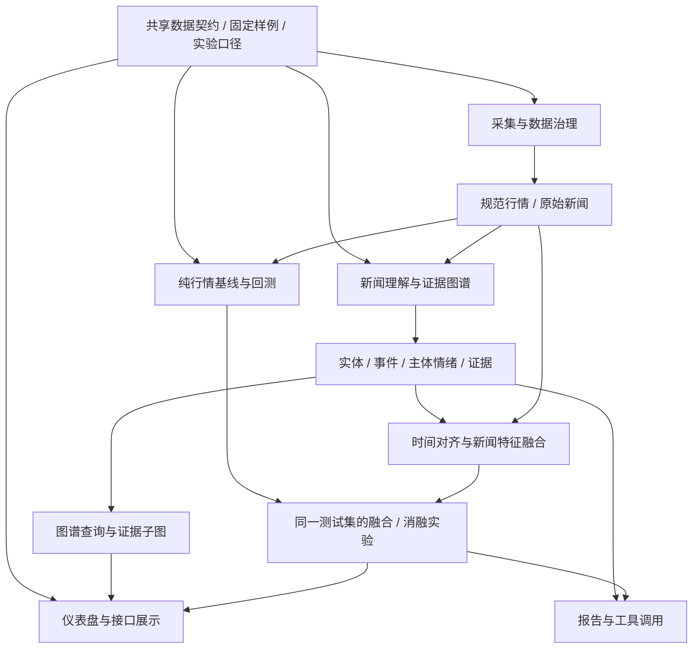

# 从 demo 到正式项目：构建任务、并行分工与文件结构

本文为后续构建方案。**第一项的 v1 数据契约和真实小批管线已落地**，见[统一数据契约](./统一数据契约.md)与[真实数据验收](./真实数据验收.md)；其余目标目录仍是设计建议，不代表已经创建。现有 demo 保持可运行。这里安排的是依赖关系、职责和交付标准，不安排日期或工期。

## 1. 建议从哪里开始

第一项具体任务是：**统一数据契约，并使一小批真实数据可以通过现有管线**。

当前先用同一行业的 2 只股票、各 78 个实际交易日与 5 篇人工核验报道完成最小验收。原先 3 只、120 日、50—100 条的建议可用于扩大开发样本，但不是本次已经采集的数据；更大的固定范围见统一契约。保持现有合成数据模式作为随时可运行的回退样例。

具体要完成：

1. 明确证券市场、唯一代码格式、时区、日频收盘时点和预测目标。
2. 选定数据源并核查字段、历史覆盖、权限、许可与限额。
3. 明确原始新闻与已处理新闻的区别，不能要求刚采集的新闻就带有正确证券关联。
4. 统一数据结构：证券、日行情、原始新闻、实体提及、事件、情绪、特征、预测、证据。
5. 建立来源和可用时间记录，补充数据质量报告。
6. 将真实数据转换到现有 CSV 契约，运行导入和报告导出，核对证券数、日期、新闻数与证据。

**完成标准**：不修改预测器和前端，就能切换合成与自有 CSV 数据；输入异常有明确报告；预测实验能说明每条信息的历史可用性。

如果历史新闻只有网站显示的发布时间，而没有可靠历史可用记录，可以先做回顾性关联分析。不能把今天抓到历史新闻的时间改写为过去的“真实首次可用时间”。当前严格 CSV 契约与未来原始采集契约应分别保留：原始记录允许未知字段，进入预测数据集前必须通过资格校验。

## 2. 需要先共享的契约

已新增 [`stocksage/contracts.py`](../stocksage/contracts.py)，用明确列名、枚举与校验函数约束 v1 的四张表与 metadata。下列更多对象是后续扩展建议。各模块内部可使用其他工具，但跨模块传递结构必须固定，禁止各写一套字段名。

| 对象 | 主要字段 | 约束 |
|---|---|---|
| Security | symbol、company_id、company、industry、aliases、market | 证券与公司主体分开识别 |
| PriceBar | symbol、date、open、high、low、close、volume、price_basis | 明确币种、复权和成交量单位 |
| RawNews | id、title、body、source、url、published_at、first_seen_at、raw_ref | 不要求已知关联证券；保存原始来源 |
| NewsDocument | id、available_at、availability_basis、version、dedup_group | 未知历史可用时间需显式标记；不得自动进入无前视预测实验 |
| EntityMention | news_id、company_id、symbol、evidence_text、method、confidence | 允许未解析，不能强行关联 |
| Event | event_id、news_id、type、subject_id、occurred_at、evidence_text | 报道时间、发生时间、可用时间不同 |
| Sentiment | news_id、target_id、score、method、version | 为具体主体记录情绪，避免多公司共用一个标签 |
| FeatureRow | symbol、as_of、values、feature_version、evidence_ids | 特征只能来自 as_of 时点已知信息 |
| Target | symbol、feature_as_of、target_date、value、label_available_at | 标签及其可观察时间单独维护 |
| ForecastResult | symbol、as_of、target、prediction、model_version、train_label_end | 可检查训练标签是否已知 |
| Evidence | id、news_id、source、url、excerpt、available_at | 摘要与图谱共同引用 |
| DatasetSnapshot | snapshot_id、schema_version、source_manifest、quality_summary | 一次运行使用固定的数据版本 |

与当前 demo 的衔接：当前 `news.csv` 是“已关联证券的规范新闻”，不是原始抓取格式。采集模块应先保存 RawNews，再由实体处理模块产生规范关联，最后导出当前 CSV 或构造等价输入。不要为了复用 CSV 而让采集器随意猜代码或事件类型。

建议新增 `configs/project.example.json`，包含证券清单、日期范围、来源名称、时区、收盘规则、数据目录与实验配置；密钥从环境变量读取。验证配置日期、未知字段与必需项，避免参数只写在启动代码里。

## 3. 可以并行的四条主线

### A. 数据采集与治理

负责：数据源适配、原始缓存、规范化、校验、去重、来源与质量记录。

目标文件：

- `stocksage/collectors/base.py`：定义采集请求、返回对象、分页/失败状态。
- `stocksage/collectors/csv_source.py`：保留离线导入能力。
- `stocksage/collectors/market_source.py`：选定行情源后的具体适配器。
- `stocksage/collectors/news_source.py`：选定新闻/公告源后的具体适配器。
- `stocksage/processing/validation.py`：唯一性、缺失、OHLC、时间与证券资格校验。
- `stocksage/processing/dedup.py`：URL、正文哈希、转载组与版本。
- `stocksage/processing/alignment.py`：可用时间与收盘日历对齐。
- `stocksage/storage.py`：存储规范与查询；由此方向负责修改，其他方向通过接口使用。

交付：来源清单、原始记录、规范记录、质量报告、同一段行情和新闻样本。

可独立推进：行情与新闻两个适配器可分别开发；二者只依赖共享的请求和记录格式。实体识别尚未完成时，保存未关联新闻即可。

### B. 新闻理解与知识图谱

负责：公司识别、实体消歧、事件抽取、主体情绪、证据组织、图谱。

目标文件：

- `stocksage/knowledge/entities.py`：代码/别名匹配、候选公司和未解析提及。
- `stocksage/knowledge/events.py`：事件类型、主体、时间与原文片段。
- `stocksage/knowledge/sentiment.py`：主体情绪接口；先保留词典实现。
- `stocksage/knowledge/graph.py`：统一节点、边、来源和证据 ID。

交付：手工标注样本、抽取记录、实体/事件/情绪评估、可追溯子图。

可独立推进：使用一批手工整理的新闻和证券别名，不必等待联网采集器。图谱首先支持查询与证据；图结构进入预测要作为单独增量实验。

### C. 特征融合与预测实验

负责：定义目标与信息时点、构造特征、基线、时间切分、回测与消融。

目标文件：

- `stocksage/features/market.py`：价格、成交量、波动等历史特征。
- `stocksage/features/news.py`：已对齐新闻的数量、情绪与事件特征。
- `stocksage/features/assemble.py`：按证券与预测时点合并，检查缺失和版本。
- `stocksage/models/baselines.py`：零收益、历史均值等基线。
- `stocksage/models/ridge.py`：岭回归拟合和预测。
- `stocksage/models/walk_forward.py`：按时点选择可用标签、逐步重训。
- `stocksage/models/metrics.py`：统一 MAE、RMSE、方向指标和样本量。

交付：特征字典、固定实验协议、逐日预测日志、基线/融合/消融指标。

可独立推进：先用当前合成数据开发纯行情模型；以固定新闻样例验证融合接口。新闻与图谱做好后再替换输入，测试窗口与标签保持一致。

需要图谱特征时再新增 `stocksage/features/graph.py`；第一版不先建空模块。模型改进要有同样日期下的对照结果，不能只凭预测曲线判断。

### D. 可视化与交互

负责：股票与日期选择、行情/事件联动、证据查询、实验结果和质量状态。

目标文件：

- `stocksage/web/index.html`：页面结构。
- `stocksage/web/style.css`：布局与视觉样式。
- `stocksage/web/app.js`：交互、图表与接口调用。
- `stocksage/server.py`：只读查询 API，接口变化由此方向统一管理。
- `tests/fixtures/dashboard.json`：固定接口样例，支持脱离真实采集和模型开发前端。

交付：对同一 API 兼容合成/自有数据的页面，能查看新闻证据、未对齐信息、模型误差与数据来源。

可独立推进：直接复用现有 API 和合成快照；不等待真实数据，也不在前端重新计算模型指标。

## 4. 编排与智能体由统一的集成人维护

`stocksage/pipeline.py` 和 `stocksage/agents.py` 先由一个集成人负责，减少四条线同时修改造成的冲突。

- 各方向实现服务函数或类，并通过共享契约交付。
- 编排器负责读取配置、调用服务、记录状态、处理失败和产物输出。
- 智能体负责基于工具结果解释或选择允许的操作，算法只在对应领域模块实现一次。
- LLM 报告和工具调用在结构化结果稳定后接入；纯行情、融合和页面功能都应继续可单独运行。
- 采集失败或抽取不确定时保留状态，不能把空结果标成“没有相关新闻”。

团队只有 2 人时：一人负责 A+B，另一人负责 C+D，明确一人集成。3 人时：A、B、C+D。4 人时：四条线各一人，一人兼集成。单人也可沿相同模块边界逐个完成。

## 5. 依赖关系：哪些可以同时做



图谱与预测有共享新闻处理结果，但不需要让全部预测流程强制经过图数据库。前端也不需要等全部算法完成，只需固定 API 样例。

## 6. 目标文件结构

以下为按需逐步形成的结构，所有 Python 子包包含 `__init__.py`。不提前批量创建空实现。

```text
StockSage/
├── run.py
├── start_demo.ps1
├── pyproject.toml
├── configs/
│   └── project.example.json
├── data/                         # 新增后在 .gitignore 中区分原始私有数据与公开样例
│   ├── raw/                      # 原始响应、原文与来源清单
│   └── processed/                # 规范数据，按 snapshot_id 保存
├── stocksage/
│   ├── contracts.py              # 共享对象、ID、字段与版本约束
│   ├── config.py                 # 配置加载与校验
│   ├── data.py                   # 迁移期间兼容入口，避免现有调用失效
│   ├── demo.py                   # 从 data.py 提取合成生成器
│   ├── collectors/
│   │   ├── base.py
│   │   ├── csv_source.py
│   │   ├── market_source.py
│   │   └── news_source.py
│   ├── processing/
│   │   ├── validation.py
│   │   ├── dedup.py
│   │   └── alignment.py
│   ├── knowledge/
│   │   ├── entities.py
│   │   ├── events.py
│   │   ├── sentiment.py
│   │   └── graph.py
│   ├── features/
│   │   ├── market.py
│   │   ├── news.py
│   │   └── assemble.py
│   ├── models/
│   │   ├── baselines.py
│   │   ├── ridge.py
│   │   ├── walk_forward.py
│   │   └── metrics.py
│   ├── agents.py                 # 角色适配，接口多后再拆子包
│   ├── pipeline.py               # 唯一流程编排入口
│   ├── storage.py
│   ├── server.py
│   └── web/
│       ├── index.html
│       ├── style.css
│       └── app.js
├── tests/
│   ├── fixtures/                 # 小型、可公开、固定接口样例
│   ├── test_stocksage.py          # 保留现有端到端和时序检查
│   ├── test_contracts.py
│   ├── test_collectors.py
│   ├── test_knowledge.py
│   └── test_experiments.py
├── docs/
│   ├── 项目计划书.md
│   ├── 构建任务与模块分工.md
│   ├── 架构与接口.md
│   └── 实验说明.md
└── output/                       # 报告、图表、模型、数据库运行产物
```

真实抓取的大文件与原始正文不直接提交 Git。少量可公开的合成/人工样例可以进入测试数据目录；密钥与授权数据需单独管理。

## 7. 现有文件如何逐步迁移

| 现有实现 | 建议归属 | 迁移约束 |
|---|---|---|
| [data.py](../stocksage/data.py) 的合成生成器 | demo.py | 默认合成模式输出与种子保持稳定 |
| [data.py](../stocksage/data.py) 的 CSV 加载与校验 | collectors/csv_source.py、processing/validation.py | data.py 暂保留转发导出，兼容现有调用 |
| [fusion.py](../stocksage/fusion.py) 的时间对齐 | processing/alignment.py | 盘后、周末、时区、末日待对齐行为不变 |
| [fusion.py](../stocksage/fusion.py) 的情绪与特征 | knowledge/sentiment.py、features/ | 特征顺序改成明确名称/版本，避免索引错配 |
| [graph.py](../stocksage/graph.py) | knowledge/graph.py | 节点、边和证据接口兼容 |
| [forecast.py](../stocksage/forecast.py) | models/ | 保留现有基线、时间切分和无未来信息检查 |
| [agents.py](../stocksage/agents.py)、[pipeline.py](../stocksage/pipeline.py) | 原位保持，逐步缩小职责 | 领域逻辑不复制到智能体提示词或编排器 |
| [server.py](../stocksage/server.py)、[web/](../stocksage/web/) | 原位保持 | 对接口增加 schema_version，避免无提示改字段 |

`fusion.py` 和 `forecast.py` 迁移时可短期保留同名兼容模块。不要在同一次改动中将所有算法改写、所有文件搬迁和所有 API 改名。

## 8. 每条线如何验收和合并

- A：输入/输出样例、来源说明、错误与重试记录、重复与缺失统计；不静默丢弃异常新闻。
- B：至少一批人工核验结果、未解析状态、原文证据；区分实体匹配正确和情绪分类正确。
- C：相同测试日期的对照、训练标签截止日、固定参数和预测日志；改未来输入不改变历史预测。
- D：固定样例与真实快照都可展示；切换证券、日期筛选、证据点击和错误状态可核验。
- 集成：运行现有端到端检查，默认离线 demo 与自有 CSV 模式同时可用。

并行协作约定：每个文件只有明确的主要负责人；共享契约的变更先更新样例与说明；模块遇到尚未完成的上游依赖时使用约定样例；合并时不重写他人负责的领域逻辑。

## 9. 下一项可直接执行的开发任务

**任务名：数据契约与真实数据入口。**

应形成的具体产物：

1. `contracts.py`、配置示例与配置校验。
2. 保留现有 CSV 接口，新增原始采集记录与规范输入之间的转换边界。
3. 将可复用的校验逻辑从混合模块中提取，保证原有测试通过。
4. 一份选定来源、字段、许可、样本日期与可用时间假设的数据决策记录。
5. 一小批真实行情/新闻或明确状态的待接入记录；有权限或历史字段缺失时如实记录，不伪造时间戳。
6. 通过命令切换数据源，并输出质量摘要；后续四条线沿上述边界开发。

其中契约、配置、校验与样例可立即实现；具体联网适配器取决于选定来源及可用权限。把这项任务完成后，模块间的接口和并行边界就有了可运行依据。
