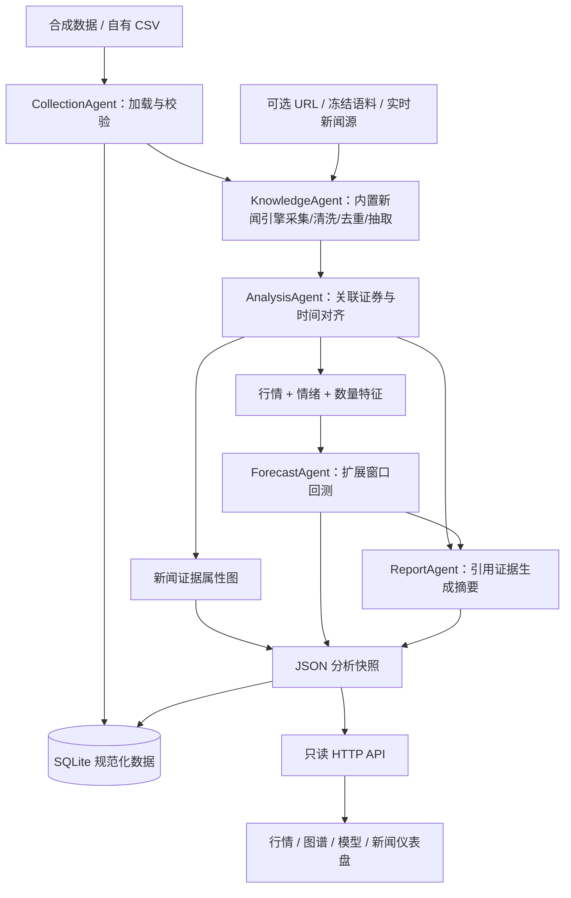

# StockSage 架构与接口

## 系统结构



## 目录与职责

```text
StockSage/
├── run.py                   # 命令行入口
├── start_demo.ps1           # Windows 启动辅助
├── pyproject.toml           # Python 版本与项目元信息
├── stocksage/
│   ├── data.py              # 合成生成器、CSV 契约、校验
│   ├── knowledge.py         # 去重/抽取编排、实体证据校验
│   ├── news_knowledge/      # 已迁入的原生新闻知识引擎
│   │   ├── sources/        # 国内财经、RSS、GDELT、Guardian、离线来源
│   │   ├── kg/             # rule / LLM / KGGen 抽取器
│   │   ├── convert.py      # 正文清洗与 Markdown
│   │   ├── dedup.py        # URL、指纹与近似去重
│   │   ├── models.py       # 文章与候选三元组
│   │   ├── config.py       # 主项目环境配置
│   │   └── assets/         # 冻结语料和合成回归样例
│   ├── news.py              # 新闻来源、正文和快照适配
│   ├── fusion.py            # 时区、收盘对齐、情绪、特征
│   ├── graph.py             # 证据属性图
│   ├── visualization.py     # PyVis 离线图谱、报告/数据库读取
│   ├── forecast.py          # 岭回归、训练窗口标准化、回测
│   ├── agents.py            # 五个角色服务，知识后端可切换
│   ├── pipeline.py          # 编排、报告与存储
│   ├── storage.py           # SQLite
│   ├── server.py            # 静态资源与 API
│   └── web/                 # HTML、CSS、JS
├── tests/                   # 关键逻辑与集成测试
├── tools/verify_standalone.py # 无原子项目副本的独立性验收
├── docs/                    # 计划、架构、实验说明
└── output/                  # 运行时创建；不纳入版本控制
```

## CSV 契约

**真实数据当前以[统一数据契约 v1.0](./统一数据契约.md)为准**。新增 [`contracts.py`](../stocksage/contracts.py) 严格校验真实输入，[`collect.py`](../stocksage/collect.py) 负责固定小批网络采集与 raw 离线重放。真实输入要求 metadata、四张 CSV 和哈希快照。

下面描述继续兼容的 **legacy 合成/未确认输入基本列**，不能仅凭这些列标记为真实数据。所有输入为 UTF-8 CSV（支持 BOM），包含列头。legacy 目录包含三张表，可另放 `metadata.json`。每只股票使用实际存在的行情日期，不自动补齐停牌日。

### stocks.csv

```csv
symbol,company,industry,aliases
600000.SH,示例公司,银行,示例公司|示例简称
```

上述公司名仅示例，不用于识别该代码的真实公司。`symbol` 必须唯一，建议显式包含交易所。别名字段用 `|` 分隔，新闻接入时用于精确长别名匹配；同名歧义不自动消解。

### prices.csv

```csv
symbol,date,open,high,low,close,volume
600000.SH,2025-01-06,10.00,10.20,9.90,10.10,1000000
```

- 每只股票至少 30 个交易日，建议至少 100 个；单行示例仅解释格式。
- `date` 使用 `YYYY-MM-DD`，每只证券每日唯一。
- OHLC 为正且有限，`high >= max(open, close)`，`low <= min(open, close)`；成交量非负。
- 所有价格保持一致复权与币种口径；demo 不执行复权。`volume` 必须统一单位。
- 当前服务处理日频沪深式 15:00 收盘语义；接入其他市场需要替换收盘日历逻辑。

### news.csv

```csv
id,title,body,source,url,published_at,available_at,symbols,event_type
N001,示例公司公布季度报告,示例正文,示例来源,https://example.com/n001,2025-01-06T16:00:00+08:00,2025-01-06T16:05:00+08:00,600000.SH,业绩
```

- `id` 非空且唯一；标题与来源必填。URL 可空，真实新闻建议填可追溯原始地址。
- 两个时间必须有 UTC 偏移；`available_at >= published_at`。
- `available_at` 表示系统或历史回测当时能取得该版本内容的时刻。不能将当前抓取到的历史文章简单假设为过去实时可用。
- `symbols` 用 `|` 连接多个已存在股票代码，至少一个，不允许重复代码。
- `event_type` 是外部输入分类，可空；当前不自动抽取事件，也不自动进行多主体情绪消歧。
- 盘后新闻归入下一有行情收盘时点。晚于数据末日收盘的新闻进入 `pending_news`，不会影响本次摘要、图谱或预测。
- 早于首个行情日的输入新闻归入首个收盘桶；正式研究应额外导入历史行情作为预热窗口，并限定新闻范围。demo 的预测特征跳过最初 5 个交易日。
- 新闻知识阶段执行同发布日内的 URL、指纹与近似去重；较晚版本的信息不回填到早期。重复 ID 会在输入校验时报错。

### metadata.json（可选）

```json
{
  "synthetic": null,
  "label": "旧格式输入 · 真实性未确认",
  "source": "自行填写来源与许可",
  "price_basis": "自行填写币种、复权口径与成交量单位",
  "availability_assumption": "自行填写时间戳的来源与精度"
}
```

无该文件时不将输入自动认定为真实数据，标签显示“用户导入 CSV · 真实性由提供者确认”。声明 `synthetic=false` 时必须提供完整 v1 契约，而非以上 legacy 示例。来源真实性和使用权限仍需人工确认。

## HTTP API

服务启动时计算一次报告，GET 请求只读取快照；修改输入后需要重新启动。

| 路径 | 返回内容 |
|---|---|
| `GET /api/health` | 状态、数据合成标记 |
| `GET /api/stocks` | 股票列表、数据集元信息、质量摘要、角色执行结果、限制 |
| `GET /api/dashboard?symbol=DEMO01` | 一只股票的价格、新闻、图谱、特征、预测与摘要 |
| `GET /api/graph?symbol=DEMO01` | 同一时点可见的节点、边、候选关系和证据 |
| `GET /graph/interactive?symbol=DEMO01` | 内置 PyVis 交互图谱；证券参数可省略 |
| `GET /` | 仪表盘 |

未知代码和资源返回 404 JSON。当前没有上传、写入、鉴权或交易 API。仅绑定本机；若部署到多人环境，需要另外实现身份验证、数据隔离与服务运维。

报告主要字段：

| 字段 | 说明 |
|---|---|
| `summary` | 收盘价格、涨跌、已对齐/待对齐新闻数、当日证据 ID |
| `news` | 已到收盘时点可用的新闻、情绪、对齐日 |
| `pending_news` | 尚未进入任何收盘桶的新闻 |
| `features` | 逐日特征、下一日标签、标签日期、证据 ID |
| `graph` | 节点、边与证据；最近最多 12 条已可用新闻 |
| `forecast.metrics` | 三个模型在相同测试窗口的指标 |
| `forecast.backtest` | 逐次预测、真实收益、训练特征和标签截止日 |
| `forecast.contributions` | 最新预测的标准化特征线性贡献 |
| `report` | 规则摘要、证据列表、生成模式 |

SQLite 表为 `stocks`、`prices`、`news`、`news_symbols`、`snapshots`，使用外键和主键约束；主表新增 `attributes_json` 保留全部规范属性，另有 `dataset_metadata` 和 `calendar_sessions` 保留口径与日历。派生图谱、特征及回测在分析快照中保存。报告新增 `quality`，同时导出质量报告、对齐表和特征表；当前并非完整的历史实验管理平台。

## 后续扩展接点

新闻知识实现已迁入主包，运行时不依赖原子项目，详见[独立化验收](./新闻知识模块独立化验收.md)。数据库新增 `knowledge_triples` 保存带新闻外键的候选关系。运行时替换新闻不改写来源 CSV，基础输入哈希与运行时正文快照清单分别保存；未到时点的关系留在采集记录，不进入股票视图。以下是进一步扩展方向。

- 数据源适配器：将服务商响应转成相同 CSV/规范记录，先复用验证器；不把 API Key 写进代码。
- 实体/事件抽取：在加载之后、时间融合之前插入抽取器，输出规范字段及原文证据，不更改预测器职责。
- 情绪：替换 `sentiment()`，同时记录模型版本与标注评估。
- 图数据库：替换图谱存取实现，仍输出 `nodes/edges/evidence_id` 给前端。
- 预测：替换 `evaluate()`，保持同一标签、切分与指标，并保留所有基线。
- LLM：通过显式工具适配器调用各角色，输出必须经过结构与证据校验；当前没有引入 LLM SDK，也不需要密钥。
